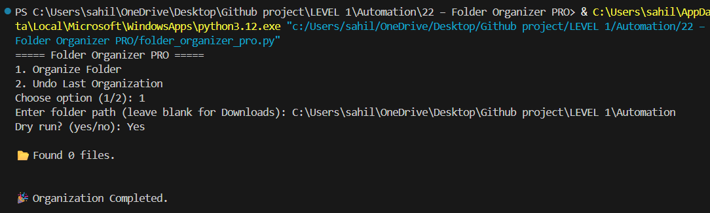

# Folder Organizer PRO

A lightweight Python command-line utility that sorts files in a chosen folder into subfolders based on file extensions. It uses Python's standard library and does not require third-party packages.

> **Status:** Personal portfolio project. File moves affect real files when dry-run is disabled. Review the preview first and keep a backup of important data. The undo feature is a simple last-operation record, not a guaranteed recovery system.



## Features

- Categorizes common image, document, video, audio, archive, and script file extensions.
- Creates category folders when needed.
- Offers a dry-run preview before moving files.
- Avoids choosing an already-existing destination filename by adding a numeric suffix.
- Saves the most recent move mapping in `undo_move.json`.
- Writes move and undo events to `organizer_log.txt`.
- Uses the current user's `Downloads` folder when no path is entered.

## Requirements

- Python 3.10 or newer recommended
- Windows, macOS, or Linux
- No external Python packages

## Quick start

1. Clone or download this repository.
2. Open a terminal in the project folder.
3. Check that Python is available:

   ```bash
   python --version
   ```

4. Start the program:

   ```bash
   python folder_organizer_pro.py
   ```

On some systems, use `python3 folder_organizer_pro.py` instead.

## How to use it

When prompted:

1. Enter `1` to organize a folder, or `2` to undo the most recently recorded organization.
2. Enter the target folder path. Leave it blank to use the default `~/Downloads` path.
3. For organization, answer `yes` to **Dry run?** to preview proposed moves without changing files. Answer `no` only after reviewing the plan.

Example session:

```text
===== Folder Organizer PRO =====
1. Organize Folder
2. Undo Last Organization
Choose option (1/2): 1
Enter folder path (leave blank for Downloads): C:\Users\YourName\Downloads
Dry run? (yes/no): yes
```

Replace the example path with a folder that exists on your computer.

## Current file categories

| Category | Extensions handled |
|---|---|
| Images | `.jpg`, `.jpeg`, `.png`, `.gif`, `.bmp`, `.webp` |
| Documents | `.pdf`, `.docx`, `.doc`, `.txt`, `.pptx`, `.xlsx` |
| Videos | `.mp4`, `.mkv`, `.mov`, `.avi` |
| Music | `.mp3`, `.wav` |
| Archives | `.zip`, `.rar`, `.7z` |
| Scripts | `.py`, `.js`, `.html`, `.css` |
| Others | Any extension not listed above |

Category matching is based on file extensions, not file contents.

## Files created at runtime

The program writes these files relative to the directory from which you launch it:

- `organizer_log.txt` — operation log
- `undo_move.json` — mapping used by the undo option

Run the script consistently from the same project directory so these records are easy to find. A new organization run replaces the previous undo mapping, so the program only retains the latest recorded operation.

## Safety notes and known limitations

- **Preview first.** Dry run is the recommended first step for any folder.
- The tool moves files when dry run is disabled; use a test folder before organizing personal or work files.
- Undo depends on the saved `undo_move.json` file and on the moved files still being present at their recorded destinations.
- The undo record is replaced on each non-dry-run organization. It is not a multi-level history.
- The program does not inspect file contents, hash files for duplicates, or detect identical files. It only avoids destination-name collisions.
- Extension lists are intentionally limited and can be expanded in `folder_organizer_pro.py`.
- The default Downloads path is built from the user's home directory; systems that store Downloads elsewhere should use an explicit path.
- The project has not been described as production-ready, and tests have not been claimed as run.

## Project structure

```text
22-Folder-Organizer-PRO/
├── folder_organizer_pro.py
├── Screenshot.png
└── README.md
```

Runtime files such as the log and undo JSON are created when you use the program.

## Possible next improvements

- Add automated tests using temporary directories.
- Add safer handling when the original destination path already exists.
- Keep a timestamped undo history rather than only the latest run.
- Add command-line arguments for target path and dry-run mode.
- Expand extension mappings and allow user configuration.

## Author

**Sahil Kumar** — Python automation and software development portfolio.

---

This README documents the current script behavior. Verify changes in a disposable test folder before using the utility on important files.
